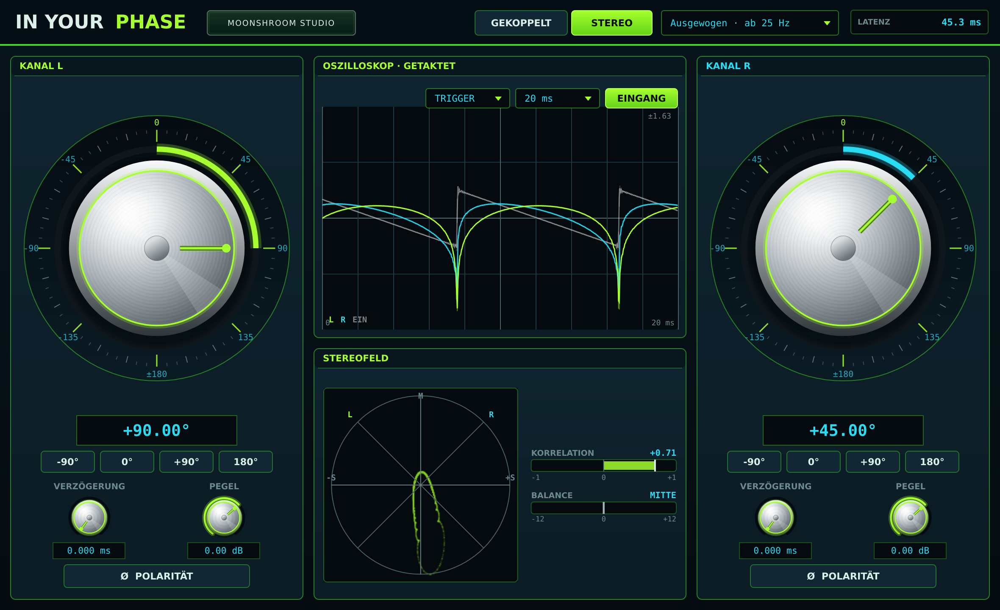

# In Your Phase

**Stufenlose 360°-Phasenrotation von Moonshroom Studio.** Freie Software für macOS, Windows und Linux, als Audio Unit, VST3, LV2 und eigenständige App.

[English](README.md) · [Website](https://moonshroom.moonshroom303.chatgpt.site/) · [SoundCloud](https://www.soundcloud.com/moonshroom303) · [YouTube](https://www.youtube.com/@moonshroom303) · [ShroomsLoops](https://shroomsloops-studio-231026.moonshroom303.chatgpt.site/#)



## Download

Fertige Versionen gibt es unter [Releases](https://github.com/moonshroom303/in-your-phase/releases/latest):

| System | Datei | Formate |
|---|---|---|
| macOS 11+ (Apple Silicon und Intel) | `InYourPhase-…-macOS-universal.zip` | Audio Unit, VST3, App |
| Windows 10/11 (64 Bit) | `InYourPhase-…-Windows-x64.zip` | VST3, App |
| Linux (x86-64) | `InYourPhase-…-Linux-x64.zip` | VST3, LV2, App |

Jedes Paket enthält eine `INSTALL.txt` mit den Zielordnern. Die Mac-Version ist ad-hoc signiert, aber nicht notarisiert. Blockiert macOS sie nach dem Download, hilft der `xattr`-Befehl aus der INSTALL.txt.

## Selbst bauen auf dem Mac

1. Den Ordner ablegen, zum Beispiel unter Dokumente.
2. **`InYourPhase-bauen.command`** starten:
   - Doppelklick. Meldet macOS „nicht verifizierter Entwickler": Rechtsklick → **Öffnen**.
   - Oder im Terminal `bash ` tippen (mit Leerzeichen), die Datei hineinziehen, Enter.
3. Das Skript lädt CMake und JUCE bei Bedarf selbst und baut dann alles:
   - **Audio Unit** nach `~/Library/Audio/Plug-Ins/Components`
   - **VST3** nach `~/Library/Audio/Plug-Ins/VST3`
   - **App** nach `~/Applications` (im Finder: „Programme“ in deinem Benutzerordner)

   Danach führt es die Tests aus und prüft die Audio Unit mit Apples `auval`.
4. In der DAW die Plugins neu scannen. In Your Phase steht unter *moonshroom studio*.

## Bedienung

**Modus GEKOPPELT:** ein großer Phasen-Knopf für beide Kanäle.
**Modus STEREO:** zwei große Phasen-Knöpfe, links und rechts. Jeder Parameter ist pro Kanal einzeln da.

**Phasen-Knopf** (der größte Regler)
- Im Kreis ziehen. Er dreht frei über ±180° hinweg, ohne Anschlag.
- Mit gehaltener **Shift**-Taste zehnfach feiner.
- **Mausrad:** 1° pro Schritt, mit Shift 0,1°.
- **Doppelklick:** zurück auf 0°.
- **Wertfeld** darunter: Doppelklick und Zahl eintippen. Komma oder Punkt gehen beide.
- **Schnellwahl:** −90°, 0°, +90°, 180°.

Pro Kanal außerdem:
- **Verzögerung:** 0 bis 25 ms, feinfühlig im Bereich weniger Millisekunden, zur Zeitausrichtung.
- **Pegel:** −24 bis +12 dB.
- **Polarität (Ø).**

**MOONSHROOM STUDIO** in der Kopfzeile öffnet die Studio-Karte mit Links zu Website, SoundCloud, YouTube und ShroomsLoops. Escape oder ein Klick daneben schließt sie.

**Qualität**: mehr Genauigkeit im Bass kostet Latenz. Die Latenz wird dem Host gemeldet und dort automatisch ausgeglichen.

| Stufe | genau ab | Latenz |
|---|---|---|
| Präzise | 12 Hz | ca. 88 ms |
| Ausgewogen (Standard) | 25 Hz | ca. 45 ms |
| Schnell | 100 Hz | ca. 13 ms |

Für Sub- und Bassarbeit „Präzise" oder „Ausgewogen" nehmen. Für Live-Monitoring, wo jede Millisekunde zählt, „Schnell".

## Analyse

**Oszilloskop, getaktet**
- **TAKT:** Jedes Bild umfasst eine Notenlänge (1/16 bis 2 Takte) und beginnt genau auf dem Raster des Hosts. Das Bild steht dadurch im Takt still. Steht der Transport, zählt eine interne Uhr mit dem Tempo des Hosts weiter.
- **TRIGGER:** Jedes Bild umfasst eine feste Zeit (2 bis 100 ms) ab einem steigenden Nulldurchgang.
- **EINGANG** blendet das unbearbeitete Signal grau ein. So sieht man die Phasendrehung direkt.
- L ist Lime, R ist Cyan. Die Skalierung passt sich automatisch an.

**Stereofeld**
- **Goniometer mit Nachleuchten.** Mono erscheint senkrecht, gegenphasig waagerecht.
- **Korrelation:** −1 bis +1. Rot heißt gegenphasig.
- **Balance** zwischen L und R in dB.

## Technik

Die Phasendrehung arbeitet nach dieser Formel:

```
y = cos(φ) · x(t − D) + sin(φ) · H{x}(t − D)
```

- **H** ist ein linearphasiger FIR-Hilbert-Transformator mit Kaiser-Fenster.
- **Faltung:** partitioniert über FFT, eigene Implementierung, damit der Qualitätswechsel synchron und auch beim Offline-Bouncen exakt passiert.
- **Winkel:** gleitet auf dem kürzesten Weg zum neuen Wert, ohne Knacken und auch über ±180° hinweg.
- **Pegel und Polarität** werden geglättet.
- **Feinverzögerung:** Lagrange-Interpolation dritter Ordnung.

Ein positiver Winkel verzögert die Phase aller Frequenzen um diesen Betrag. Bei 0° kommt das Signal unverändert heraus, nur um die Latenz verzögert. Bei 180° ist es invertiert.

## Stand der Prüfung

- **Tests** laufen bei jedem Push auf GitHub unter macOS, Windows und Linux:
  - Die Faltung stimmt mit einer direkten Faltung überein.
  - 0° ist eine exakte Identität, 180° eine exakte Inversion.
  - Die Phasendrehung ist über das ganze Spektrum konstant, bei 30°, 90°, −120° und 179° in allen drei Qualitätsstufen auf unter 0,5° und 0,1 dB genau, auch bei 44,1 kHz und 96 kHz.
  - Verzögerung, Polarität, Pegel, Kanaltrennung, Qualitätswechsel, sprungfreie Winkeländerung, gekoppelter Modus und das Speichern des Zustands sind abgedeckt.
  - Ebenso das Oszilloskop im Takt, mit interner Uhr und im Trigger-Modus, Korrelation und Balance sowie die Studio-Karte.
- **Audio Unit:** wird auf GitHub mit Apples `auval` geprüft.

## Für Entwickler

```bash
cmake -S . -B build -DCMAKE_BUILD_TYPE=Release
cmake --build build --config Release
./build/InYourPhaseTests_artefacts/Release/InYourPhaseTests
```

JUCE 8.0.15 wird beim ersten Konfigurieren automatisch geladen. Ein vorhandenes JUCE lässt sich mit `-DJUCE_DIR=/pfad/zu/JUCE` nutzen. `-DLP_COPY_PLUGINS=OFF` verhindert das Kopieren in die Plugin-Ordner.

`.github/workflows/build.yml` baut alle Plattformen. Ein Tag `v*` erstellt automatisch ein Release mit den Paketen und SHA-256-Prüfsummen.

## Lizenz

In Your Phase ist freie Software unter der [GNU Affero General Public License v3](LICENSE). Es nutzt [JUCE](https://juce.com) unter dessen AGPLv3-Lizenz.

Copyright © 2026 Moonshroom Studio
