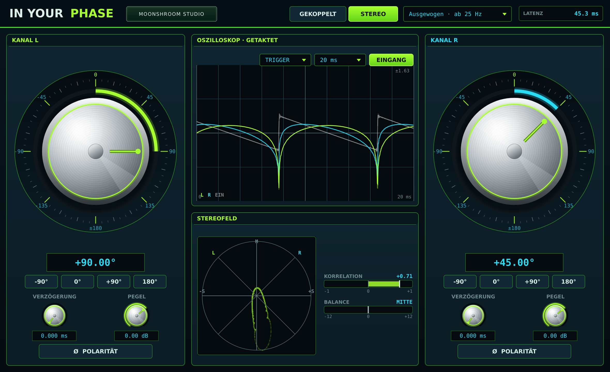

# In Your Phase

**Continuous 360° phase rotation by Moonshroom Studio.** Free software for macOS, Windows and Linux, as Audio Unit, VST3, LV2 and standalone app.

[Deutsch](README.de.md) · [Website](https://moonshroom.moonshroom303.chatgpt.site/) · [SoundCloud](https://www.soundcloud.com/moonshroom303) · [YouTube](https://www.youtube.com/@moonshroom303) · [ShroomsLoops](https://shroomsloops-studio-231026.moonshroom303.chatgpt.site/#)



## Download

Ready-to-use builds are on the [Releases page](https://github.com/moonshroom303/in-your-phase/releases/latest):

| System | File | Formats |
|---|---|---|
| macOS 11+ (Apple Silicon and Intel) | `InYourPhase-…-macOS-universal.zip` | Audio Unit, VST3, app |
| Windows 10/11 (64-bit) | `InYourPhase-…-Windows-x64.zip` | VST3, app |
| Linux (x86-64) | `InYourPhase-…-Linux-x64.zip` | VST3, LV2, app |

Each package contains an `INSTALL.txt` with the target folders. The macOS build is ad-hoc signed but not notarized. If macOS blocks it after downloading, run the `xattr` command from `INSTALL.txt` once.

## What it does

- **360° phase rotation:** rotates the phase of all frequencies by the same angle, continuously and without a stop at ±180°.
- **Coupled or stereo:** one angle for both channels, or a separate angle for left and right.
- **Per channel:** fine delay up to 25 ms for time alignment, level (−24 to +12 dB) and polarity.
- **Oscilloscope:** synced to the host tempo or triggered on rising zero crossings, with the dry input overlaid for comparison.
- **Goniometer, correlation and balance:** the stereo field at a glance.
- **Three quality levels:** accurate from 12, 25 or 100 Hz. The latency is reported to the host and compensated.

The interface is in German. Phase knob: drag in a circle, Shift for fine steps, mouse wheel for 1° steps, double-click for 0°. Quick buttons set −90°, 0°, +90° and 180°.

**MOONSHROOM STUDIO** in the header opens the studio card with links to the website, SoundCloud, YouTube and ShroomsLoops. Escape or a click outside closes it.


| Quality | Accurate from | Latency |
|---|---|---|
| Präzise | 12 Hz | about 88 ms |
| Ausgewogen (default) | 25 Hz | about 45 ms |
| Schnell | 100 Hz | about 13 ms |

## How it works

```
y = cos(φ) · x(t − D) + sin(φ) · H{x}(t − D)
```

- **H** is a linear-phase FIR Hilbert transformer with a Kaiser window, applied by a partitioned FFT convolution. Quality changes happen synchronously, also when bouncing offline.
- The angle glides along the shortest path to a new value, without clicks, also across ±180°.
- The fine delay uses third-order Lagrange interpolation.

A positive angle delays the phase of all frequencies by that amount. At 0° the signal is unchanged apart from the latency; at 180° it is inverted.

## Building

Requirements: CMake 3.22+, a C++17 compiler (Xcode, Visual Studio 2022 or GCC/Clang) and git. JUCE 8.0.15 is downloaded automatically on the first configure.

```bash
cmake -S . -B build -DCMAKE_BUILD_TYPE=Release
cmake --build build --config Release
./build/InYourPhaseTests_artefacts/Release/InYourPhaseTests
```

- `-DJUCE_DIR=/path/to/JUCE` uses an existing JUCE checkout.
- `-DLP_COPY_PLUGINS=OFF` skips copying the plug-ins to your user plug-in folders.
- On Linux, install the JUCE dependencies first, for example on Ubuntu: `libasound2-dev libfreetype-dev libfontconfig1-dev libx11-dev libxcomposite-dev libxcursor-dev libxext-dev libxinerama-dev libxrandr-dev libxrender-dev libgl1-mesa-dev`.
- On a Mac, `InYourPhase-bauen.command` does everything in one double-click, including `auval`.

`.github/workflows/build.yml` builds and tests all three platforms on every push. Pushing a tag `v*` publishes a release with the packages and SHA-256 checksums. Alternatively, run the **Build** workflow manually (Actions → Build → Run workflow) with *publish* ticked and a version number: it creates the tag and the release.

## License

In Your Phase is free software under the [GNU Affero General Public License v3](LICENSE). It uses [JUCE](https://juce.com) under its AGPLv3 license.

Copyright © 2026 Moonshroom Studio
